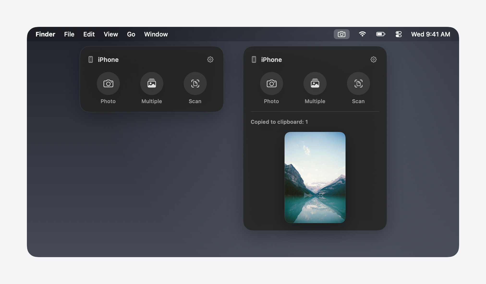
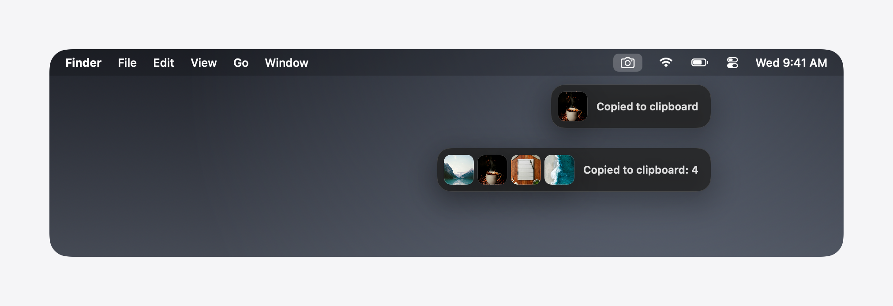

# iPhone Photo

Take a photo with your iPhone and get it straight onto your Mac's clipboard, from the menu bar.

It is a small menu bar app built on Apple's **Continuity Camera** (the same feature behind *Import from iPhone or iPad* when you right-click the desktop). Instead of digging through that menu and getting a file on your desktop, you click the camera icon, shoot, and press ⌘V wherever you want the photo.



## Features

- **Photo**: one tap opens the camera on your iPhone. The photo lands on the clipboard.
- **Multiple**: keeps reopening the camera after every shot until you close it on the iPhone. Every photo goes on the clipboard together, so one ⌘V pastes them all.
- **Scan**: scan documents with the iPhone (multi-page scans become one PDF).
- **Sketch**: draw on an iPad or iPhone and paste the sketch (off by default, turn it on in Settings).
- **Small preview toast** under the icon after each capture, and a summary row when a multi-photo session ends.
- Photos are copied **as images and as files**, so they paste into chats, AI apps, documents and Finder.
- Click a thumbnail in the panel to open it, or drag it into another app.
- Native look: Liquid Glass on macOS 26, monochrome Control Center style buttons, no Dock icon.



## Requirements

- macOS 13 Ventura or later (Apple Silicon or Intel).
- An iPhone or iPad with iOS/iPadOS 12 or later, signed in to the **same Apple Account** as the Mac.
- Wi‑Fi and Bluetooth turned on on both devices, and the iPhone unlocked and nearby.

These are the same requirements as [Continuity Camera](https://support.apple.com/en-us/102647).

## Install

1. Download `iPhone-Photo.zip` from the [latest release](../../releases/latest).
2. Unzip it and move **iPhone Photo.app** to your Applications folder.
3. Open it. The app is not notarized by Apple, so the first time macOS will block it. Go to **System Settings → Privacy & Security**, scroll down and click **Open Anyway**. You only need to do this once.

   If you prefer the Terminal:

   ```bash
   xattr -d com.apple.quarantine "/Applications/iPhone Photo.app"
   ```

A camera icon appears in the menu bar. To keep it there after a restart, turn on **Open at login** in Settings (the gear icon in the panel).

## Build from source

You only need the Xcode Command Line Tools (`xcode-select --install`).

```bash
git clone https://github.com/alonso-reyna/iphone-to-clipboard.git
cd iphone-to-clipboard
./build.sh
```

`./build.sh` builds a universal app and installs it into `~/Applications`. `./build.sh --release` builds `build/iPhone-Photo.zip` instead.

The whole app is a single file, [`main.swift`](main.swift) (AppKit + SwiftUI, no dependencies).

## How it works

Continuity Camera has no public "take a photo now" API for menu bar apps. The app gets there like this:

1. It places the system *Import from iPhone* item (`NSMenuItem.importFromDeviceIdentifier`) in its own main menu, which is never shown. macOS only fills in the device list there, not in status bar menus.
2. It registers image types as service return types and keeps a nearly invisible window as the receiver of the photo.
3. When you pick an action in the panel, it triggers the matching item of that hidden menu. The photo arrives through `NSServicesMenuRequestor.readSelection(from:)`.
4. The "Take a photo with…" alert blocks until it closes. If it closes without a photo, the capture was cancelled, which is how a multi-photo session knows when to stop.

Captures are kept in `~/Library/Caches/iPhonePhoto` so they can be pasted as files. The folder is cleared when the next capture arrives.

## Credits

The hidden main menu trick comes from [continuity-capture](https://github.com/techjuicelab/continuity-capture) by techjuicelab, a hotkey-driven Continuity Camera helper. Worth a look if you prefer keyboard shortcuts.

Sample photos in the screenshots are from [Unsplash](https://unsplash.com): [Lake Louise](https://unsplash.com/photos/lake-louise-mountains-and-glacier-lpjb_UMOyx8) by Daniel Roe, [coffee cup](https://unsplash.com/photos/white-ceramic-teacup-with-coffee-beans-lsmu0rUhUOk) by Ante Samarzija, [notebook](https://unsplash.com/photos/black-pen-on-white-notebook-Hx-4TbpsoIw) by Justin Morgan and [seashore](https://unsplash.com/photos/aerial-photo-of-seashore-sLAk1guBG90) by Shifaaz Shamoon.

## License

[MIT](LICENSE)
